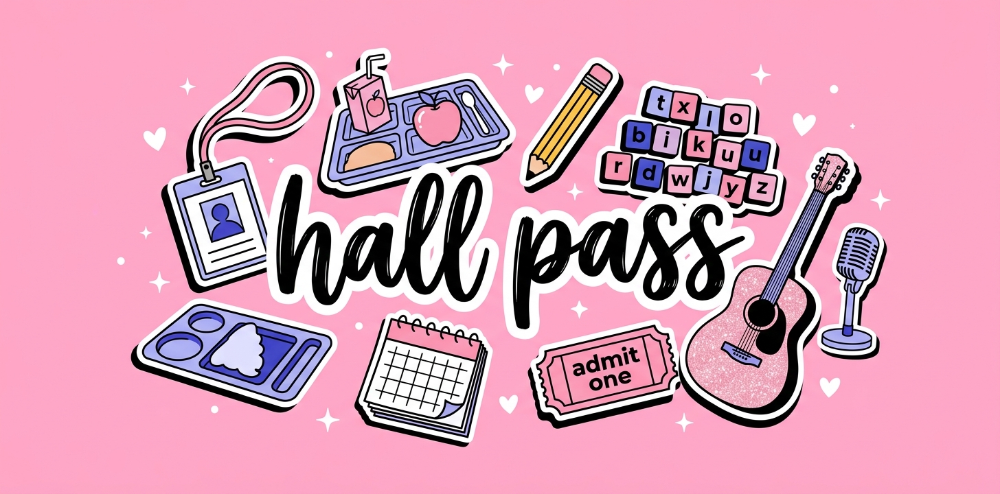

# hall pass 🎟️



Small tools that make life with a school-age kid a little easier. Built for Fallsmead, shared in case your school needs the same thing.

| Project | What it does | Try it |
|------------------------|------------------------|------------------------|
| [`lunchline/`](lunchline/) | Scrapes the school cafeteria menu into a `.ics` file you can import into Google Calendar, so "what's for lunch, can I pack instead?" is answered before Monday morning. | R + Quarto, [read more](lunchline/README.md) |
| `spelling_4_U/` | **Pop Quiz, Pop Star**, a pink pop-concert spelling game that gets a 5th grader ready for the weekly test. Works on a laptop or iPad, no install. | [Play it](https://klinares.github.io/hall-pass/spelling/) |

## How the repo is laid out

```         
hall-pass/
├── lunchline/     R + Quarto pipeline for cafeteria menus
├── spelling/      static HTML spelling game, hosted with GitHub Pages
└── README.md      you are here
```

Each project lives in its own folder with its own README, so they never get in each other's way.

## Hosting

The spelling game is a single static HTML file served by **GitHub Pages** (Settings → Pages → deploy from the `main` branch, root folder). Anything in the repo is then reachable at `https://klinares.github.io/hall-pass/<folder>/`.

## Adding a new project

1.  Make a new folder (e.g. `math-facts/`).
2.  Give it a short `README.md`: what it does, how to run it.
3.  Add a row to the table above.

## License

MIT. Have at it.
