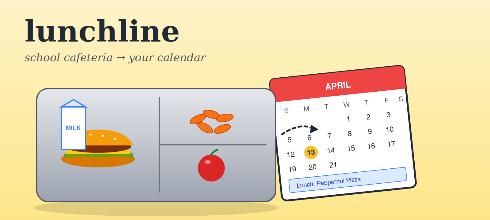

<p align="center">

</p>

# lunchline



Scrape your kid's school cafeteria menu into a `.ics` file you can upload to Google Calendar — all from R.

The pain this solves: every Monday morning, the question is *"what's for lunch today, can I pack instead?"* The cafeteria publishes menus on a clunky [MealViewer](https://schools.mealviewer.com) page that nobody remembers to check. This pulls them down, formats them as nice all-day calendar events, and writes them to a single `.ics` file you import into Google Calendar.

## How it works

1.  **Scrape** — hits the public MealViewer JSON API and walks the four-level nest of `menuSchedules → menuBlocks → cafeteriaLineList → foodItemList`.
2.  **Shape** — collapses each `(date, meal_type)` into a single all-day event, with a clean headline (skipping the daily-repeat items like cereal and yogurt) and a full menu in the description.
3.  **Emit** — writes a properly-escaped RFC 5545 `.ics` file. Event UIDs are deterministic per `(date, meal)`, so re-uploading the file updates events in place instead of duplicating them.

Everything lives in one Quarto document, [`lunchline.qmd`](lunchline.qmd), which doubles as runnable code and as the documentation you're reading the executive summary of.

## Quick start

``` r
# one-time:
install.packages(c("tidyverse", "httr2", "lubridate", "cli"))

# render the whole pipeline:
quarto::quarto_render("lunchline.qmd")
```

That produces `fallsmead_menus.ics`. To get it into Google Calendar:

1.  Open [Google Calendar](https://calendar.google.com) in a browser.
2.  **Settings → Import & export**.
3.  **Select file from your computer** → pick `fallsmead_menus.ics` → choose the destination calendar → **Import**.

When new menus are published, re-render and re-upload. Google Calendar matches on UID, so existing events update in place and only genuinely new ones get added — no duplicates.

## Configuring for a different school

Open `lunchline.qmd` and change two constants:

``` r
SCHOOL_KEY  <- "FallsmeadES"   # the slug from your school's mealviewer URL
SCHOOL_NAME <- "Fallsmead ES"  # display name used in event titles
```

Find your school's key by visiting [`schools.mealviewer.com`](https://schools.mealviewer.com), searching for your school, and copying the trailing slug from the URL.

## What's in the repo

| File                  | Purpose                                          |
|-----------------------|--------------------------------------------------|
| `lunchline.qmd`       | The whole pipeline + documentation. Render this. |
| `README.md`           | This file.                                       |
| `hero.png` / `hero.svg` | The fun image up top. SVG is the source; PNG is what GitHub renders. |
| `.gitignore`          | Standard R / Quarto ignore rules.                |
| `fallsmead_menus.ics` | Latest scraped menus (regenerated every render). |

## Design notes

A few things that were worth getting right rather than fast:

-   **Idempotent UIDs.** The previous version of this script used `Sys.time()` in the UID, which meant every re-scrape produced fresh UIDs and re-uploading the .ics created duplicate events. We now derive a stable UID from the date and meal type, so re-imports cleanly update in place.
-   **Proper RFC 5545 escaping.** Item names contain commas (`Chik'N Nuggets w/ Green Beans, Corn, and Dinner Roll`), which would break the ICS format if dropped in raw. We escape commas, semicolons, backslashes, and newlines per spec.
-   **Word-boundary line folding.** RFC 5545 caps lines at 75 octets. The naive fix breaks mid-word (`Buffalo Chicken & C` ... `heese Croissant`), which a few calendar clients render literally. We break at the last space before the limit instead, so the file stays readable everywhere.
-   **Quarto, not Shiny.** The original concept floated a Shiny dashboard with a date picker. A dashboard you have to open and click defeats the goal of "as automated as possible" — Quarto + a render command just runs.

## License

MIT. Have at it.
